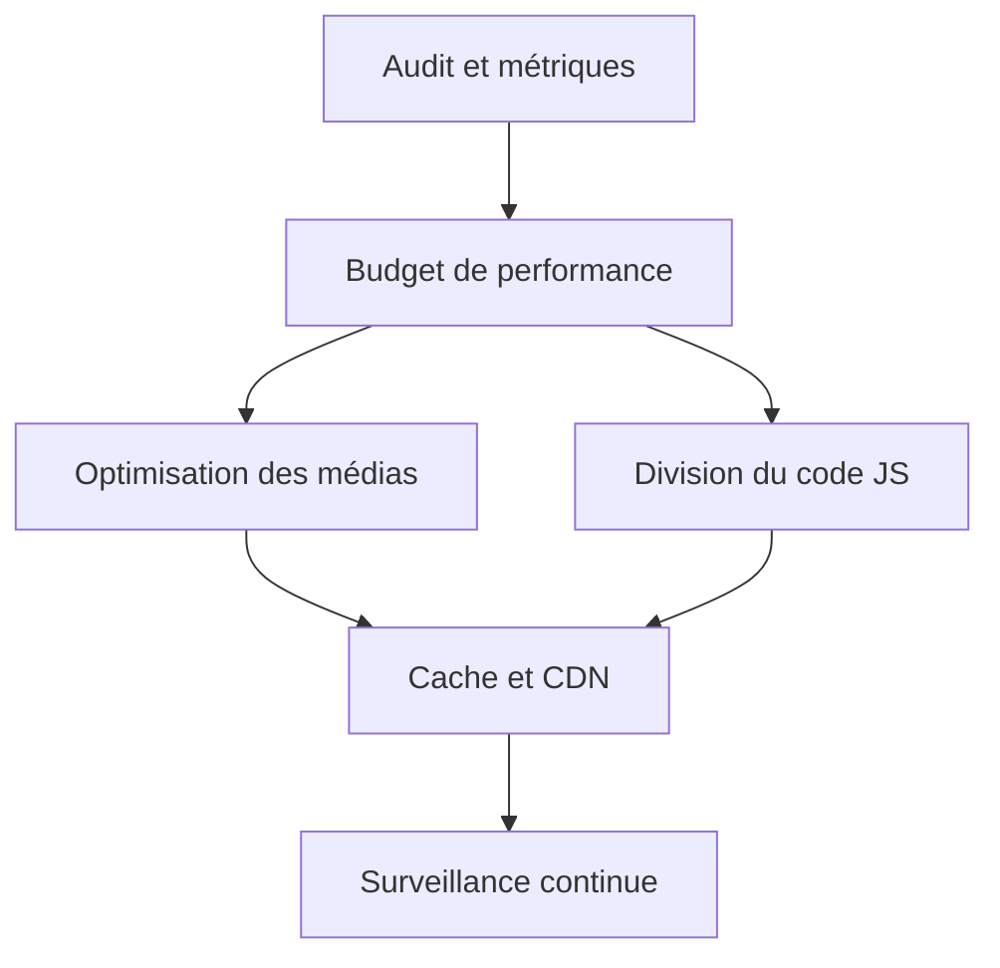

## Objet de la note

Cette note cadrage formalise le lancement d’un chantier de **performance web** au sein du **Collectif Horizon**, réseau fictif d’associations culturelles. Elle définit le périmètre, les objectifs mesurables et les jalons de l’année à venir.

Le constat est simple : la plateforme mutualisée du réseau a vu son trafic doubler, mais ses temps de chargement se sont dégradés jusqu’à devenir un frein à la participation.

## Périmètre

Le chantier couvre trois surfaces :

- Le portail public et l’agenda des événements.
- L’espace de billetterie.
- Les back-offices de saisie pour les équipes.

Les applications internes hors web (édition, comptabilité) sont explicitement exclues.

## Objectifs et indicateurs

Nous retenons les indicateurs standard du terrain, complétés par deux mesures métier.

| Indicateur | État initial | Cible 6 mois | Cible 12 mois |
| --- | --- | --- | --- |
| LCP (mobile) | 4,8 s | 2,5 s | 2,0 s |
| INP | 420 ms | 200 ms | 150 ms |
| CLS | 0,21 | 0,10 | 0,05 |
| Poids page accueil | 2,9 Mo | 1,2 Mo | 0,8 Mo |
| Taux d’abandon billetterie | 38 % | 25 % | 18 % |

## Architecture cible

Le chantier s’articule autour de quatre leviers techniques complémentaires.

Ce diagramme résume l’enchaînement **mesurer → borner → optimiser → surveiller**, qui structure toute la démarche.

## Jalons

1. **T1** — audit complet, mise en place du monitoring et définition du budget de performance.
2. **T2** — optimisations médias et découpage du JavaScript.
3. **T3** — cache, CDN et refonte des chemins critiques.
4. **T4** — industrialisation et passage en fonctionnement courant.

## Risques et vigilance

- Le poids des images éditoriales, souvent oubliées car gérées hors équipe technique.
- Les régressions silencieuses : d’où l’importance d’un **test automatisé de budget** dans la chaîne d’intégration.
- La tentation d’optimiser sans mesure : chaque gain doit être relié à un indicateur.

## Cadre de suivi

Un tableau de bord public interne sera mis à jour chaque semaine. Les objectifs sont revus à mi-parcours afin d’ajuster le tir selon les premiers résultats mesurés.

